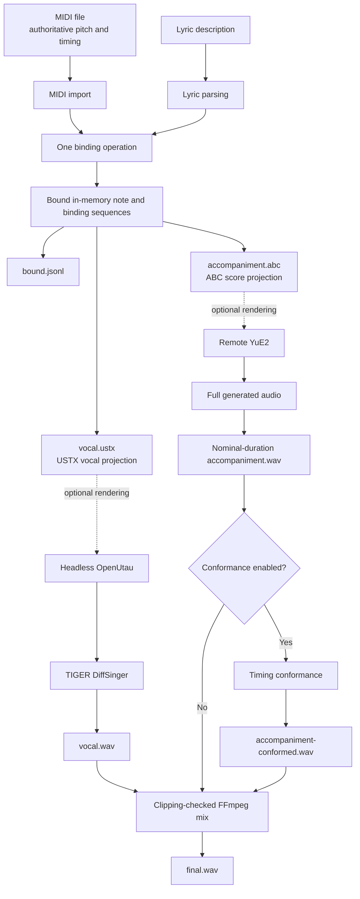

# Melisma

Melisma binds a monophonic MIDI note sequence to a compact lyric description,
then projects the same bound timeline into renderer-specific artifacts. MIDI is
the authoritative source of pitch, note onset, note duration, and composition
length. The lyric file says which MIDI notes are lyrical onsets, continuations,
or untexted notes.

The `render-inputs` command creates three views of one binding operation:

- `bound.jsonl` is the inspectable bound intermediate representation.
- `vocal.ustx` is the OpenUtau vocal projection.
- `accompaniment.abc` is the symbolic score projection used by the YuE2
  accompaniment workflow.

Melisma is not a DAW, MIDI editor, synthesizer, or standalone music model. The
C program materializes deterministic renderer inputs. The optional Python
pipeline coordinates external vocal and accompaniment renderers, transport,
verification, timing conformance, and mixing.

## Architecture



The C executable imports MIDI once, parses lyrics once, binds once, and
serializes the resulting note and binding sequences. The Python pipeline in
`tools/melisma_pipeline.py` runs that command and then handles OpenUtau
rendering, SSH/SCP transport, YuE2 rendering and verification, optional
piecewise timing conformance, and final FFmpeg mixing.

## Build

The build requires CMake 3.16 or newer, a C compiler, Bison, and Flex. The
configured test build also requires a Python 3 interpreter.

```sh
cmake -S . -B build
cmake --build build
ctest --test-dir build --output-on-failure
```

The repository establishes this CMake build and test flow. It does not declare
or test a broader platform or compiler support matrix.

## Quick start

After completing the build above, generate all three renderer inputs from the
minimal fixture:

```sh
rm -rf -- build/quick-start-render-inputs
./build/melisma render-inputs \
  --singer TIGER_DS_v102 \
  --phonemizer OpenUtau.Core.DiffSinger.DiffSingerARPAPlusEnglishPhonemizer \
  --renderer DIFFSINGER \
  examples/five-notes.mid \
  examples/gloria.txt \
  build/quick-start-render-inputs
```

The output directory contains:

```text
bound.jsonl
vocal.ustx
accompaniment.abc
```

Use `bound.jsonl` to inspect the MIDI-to-lyric binding. `vocal.ustx` is the
vocal renderer input, and `accompaniment.abc` is the symbolic accompaniment
score. See [C command-line interface](#c-command-line-interface) for individual
serializers and [End-to-end Python pipeline](#end-to-end-python-pipeline) for
OpenUtau/DiffSinger, YuE2, conformance, and mixing.

## Input model

### MIDI

The importer accepts Standard MIDI format 0 with one track and a
ticks-per-quarter-note division. It produces an ordered, non-overlapping note
sequence. Each note carries:

- MIDI pitch;
- absolute onset in MIDI ticks;
- duration in MIDI ticks.

The current importer is intentionally monophonic. A new note-on while another
note is active, a mismatched note-off, a zero-duration note, overlapping notes,
or an unsupported MIDI container shape is rejected.

### Lyric syntax

The lexer and grammar recognize:

| Input | Meaning |
|---|---|
| `[A-Za-z]+` | Alphabetic lyrical onset token |
| `--` | Add one continuation note to the preceding lyrical token |
| `_` | One untexted MIDI note |
| `|` | Optional final delimiter after the lyrical sequence |
| whitespace | Ignored |
| `#` through end of line | Ignored as a comment |
| `-` | Accepted and ignored |
| three or more consecutive `-` characters | Invalid |

The binder requires the lyric description to account for exactly the imported
MIDI note count.

```text
required notes =
    untexted elements
  + lyrical onsets
  + continuation markers
```

One lyrical token consumes one onset note, each `--` consumes one continuation
note, and each `_` consumes one untexted note.

For the OpenUtau/DiffSinger path, preserve complete lexical words when a word
spans notes:

```text
ruins --
Glory --
rises --
eternal -- --
```

For example:

```text
Glory --
```

binds one onset and one continuation. The USTX projection emits the two lyrics:

```text
Glory
+
```

When those notes are exactly contiguous, OpenUtau groups the plain `+` note
with the preceding lyrical note. DiffSinger performs G2P once on `Glory` and
can distribute vowel or syllable starts across the grouped notes. Plain `+`
therefore should not be described only as a sustained-vowel marker in this
workflow.

Manually splitting lexical words:

```text
Glo ry
ris es
ru ins
```

creates separate lyrical onsets and separate G2P queries, which can reduce
English pronunciation quality. This repository does not otherwise document
the distinct OpenUtau `+~` and `+*` conventions.

## C command-line interface

Run `./build/melisma` after building.

### Single output

```text
melisma [--format ir|abc|ustx] [--singer NAME] [--phonemizer CLASS] [--renderer NAME] MIDI_FILE LYRIC_FILE [OUTPUT_FILE]
```

The default format is `ir`. If `OUTPUT_FILE` is omitted, output is written to
standard output.

```sh
# Bound JSON Lines IR on standard output
./build/melisma \
  examples/five-notes.mid \
  examples/gloria.txt

# ABC score
./build/melisma \
  --format abc \
  examples/five-notes.mid \
  examples/gloria.txt \
  accompaniment.abc

# Configured USTX
./build/melisma \
  --format ustx \
  --singer TIGER_DS_v102 \
  --phonemizer OpenUtau.Core.DiffSinger.DiffSingerARPAPlusEnglishPhonemizer \
  --renderer DIFFSINGER \
  examples/five-notes.mid \
  examples/gloria.txt \
  vocal.ustx
```

`--singer`, `--phonemizer`, and `--renderer` populate USTX track metadata.
They are accepted by the single-output command only when `--format ustx` is
selected.

### Multi-output renderer inputs

```text
melisma render-inputs [--singer NAME] [--phonemizer CLASS] [--renderer NAME] MIDI_FILE LYRIC_FILE OUTPUT_DIR
```

Validated fixture:

```sh
./build/melisma render-inputs \
  --singer TIGER_DS_v102 \
  --phonemizer OpenUtau.Core.DiffSinger.DiffSingerARPAPlusEnglishPhonemizer \
  --renderer DIFFSINGER \
  examples/five-notes.mid \
  examples/gloria.txt \
  build/five-notes-render-inputs
```

`render-inputs`:

1. imports MIDI once;
2. parses lyrics once;
3. binds once;
4. serializes the same in-memory note and binding sequences to all three
   outputs;
5. refuses to overwrite an existing nonempty output directory;
6. writes temporary files, flushes and closes every stream, and publishes the
   bundle only after all three serializations succeed.

On failure, temporary files and any partially published bundle files are
removed.

## Output artifacts

### `bound.jsonl`

The first JSON Lines record is a header:

```json
{"type":"header","version":1,"ticks_per_quarter":480}
```

Each following record contains the MIDI note's `pitch`, absolute `onset`,
`duration`, binding type, and syllable. Binding types are `onset`,
`continuation`, and `untexted`. An untexted record has `"syllable": null`;
onset and continuation records carry the associated lyric text.

### `vocal.ustx`

The USTX serializer includes lyrical onset and continuation notes and omits
untexted notes from the vocal note list. It does not compact the remaining
notes: later vocal notes retain their absolute MIDI positions. The voice-part
duration is the maximum end tick of the complete source note sequence, so an
instrumental intro, interlude, or outro remains represented in the composition
timeline even though those notes are absent from the DiffSinger vocal list.

Onsets use the complete lyric text. Continuations use plain `+`. Singer,
phonemizer, and renderer metadata come from the corresponding command options.
The current projection writes USTX version 0.7 with a 120 BPM, 4/4 project
header.

### `accompaniment.abc`

The ABC serializer uses every imported MIDI note, including notes marked
untexted for vocals. Its current output is a 120 BPM, 4/4, `L:1/32` score with
two declared voices:

- `Vocal` carries the full source MIDI melody and rests;
- `Ins` carries measure rests.

This exact two-voice representation is tested as the symbolic score input for
the YuE2 workflow. No broader claim of compatibility with arbitrary ABC tools
or notation is made.

## Instrumental-section timing invariant

The committed regression fixture consists of:

- `examples/intro-vocal-interlude.mid`
- `examples/intro-vocal-interlude.txt`

It has four instrumental notes, four vocal notes, and four more instrumental
notes. At 480 ticks per quarter note, the automated regression proves:

```text
source MIDI first vocal onset       = 1920 ticks
bound IR first vocal onset          = 1920 ticks
USTX first vocal absolute onset     = 1920 ticks
ABC corresponding onset             = 4 quarter notes
```

All twelve source notes remain in `bound.jsonl` and `accompaniment.abc`.
Only the four lyrical notes appear in the USTX vocal-note list. See
`docs/timing-regression-acceptance.md` and
`tools/accept_diffsinger_timing.py`.

## Headless OpenUtau rendering

Melisma generates USTX but does not synthesize vocals. With a separate,
built OpenUtau-CLI checkout:

```sh
dotnet run \
  --project ../OpenUtau-CLI/OpenUtau.Cli/OpenUtau.Cli.csproj \
  -- \
  render INPUT.ustx \
  --out OUTPUT.wav
```

Singer, phonemizer, and renderer selection must already be embedded in
`INPUT.ustx`. OpenUtau-CLI and the `TIGER_DS_v102` voicebank are external
dependencies and are not bundled with Melisma.

## End-to-end Python pipeline

`tools/melisma_pipeline.py` orchestrates the complete prototype workflow.
Required options are MIDI, lyrics, output directory, singer, phonemizer,
renderer, YuE2 style and seed, RunPod host, port and user, and an SSH identity
file.

```sh
python3 tools/melisma_pipeline.py \
  --midi examples/intro-vocal-interlude.mid \
  --lyrics examples/intro-vocal-interlude.txt \
  --output build/pipeline/intro-vocal-interlude \
  --singer TIGER_DS_v102 \
  --phonemizer OpenUtau.Core.DiffSinger.DiffSingerARPAPlusEnglishPhonemizer \
  --renderer DIFFSINGER \
  --style "Instrumental, simple piano, no vocals, no singing, no choir, no spoken words" \
  --seed SEED \
  --runpod-host RUNPOD_HOST \
  --runpod-port RUNPOD_PORT \
  --runpod-user RUNPOD_USER \
  --ssh-key ~/.ssh/id_ed25519
```

The RunPod host and port have no defaults. Other optional controls are:

| Option | Default or role |
|---|---|
| `--ssh-connect-timeout` | 10 seconds; accepted range is 1 through 120 |
| `--melisma` | `./build/melisma` |
| `--openutau-project` | OpenUtau CLI project path |
| `--yue2-repository` | `/workspace/YuE` |
| `--vocal-gain` | `0.5` |
| `--accompaniment-gain` | `1.0` |
| `--master-gain` | `0.707945784` |
| `--accompaniment-conformance-anchors` | Enable manual piecewise timing conformance |
| `--verbose` | Print external commands and captured output |
| `--resume` | Resume from a compatible manifest |

SSH uses `IdentitiesOnly=yes`, `BatchMode=yes`, the configured key and port,
and a bounded `ConnectTimeout`. SCP uses `IdentitiesOnly=yes` plus the
configured key and port. The implementation does not disable normal SSH
host-key checking.

### Execution stages

Stages run in this order:

1. `preflight`
2. `melisma-render-inputs`
3. `openutau-vocal-render`
4. `create-remote-run`
5. `upload-accompaniment-abc`
6. `inspect-uploaded-abc`
7. `prepare-yue2`
8. `inspect-prepared-score`
9. `generate-yue2`
10. `verify-yue2-generation`
11. `locate-generated-audio`
12. `download-full-accompaniment`
13. `extract-accompaniment`
14. `conform-accompaniment`
15. `mix-final`
16. `validate-final-mix`

The conformance stage is a no-op unless an anchor file is supplied. Preflight
checks local inputs and tools and confirms that the expected YuE2 scripts exist
on the remote host before rendering begins.

### Resume behavior

`--resume` requires a usable `manifest.json` and compatible input paths and
configuration. MIDI, lyrics, and optional anchor contents are checked by
SHA-256 during preflight.

For a completed stage with a validator, resume verifies the recorded artifact
or remote state before skipping the action. If validation fails, that stage
and later stages become pending and are rerun. A stage recorded as running is
changed to interrupted when the manifest is prepared for resume. The
preflight stage always runs. Pipeline failures record the failed stage, error,
external exit status, and captured standard output or error when available.
A keyboard interruption records pipeline and stage status as `interrupted`.

A specific downstream transition is supported: a previously successful run
with accompaniment conformance absent or disabled may be resumed with an
explicit anchor file. All stages through `extract-accompaniment` must already
be successful and must pass their resume validators. Their artifacts are
preserved. Only these stages are invalidated and rerun:

```text
conform-accompaniment
mix-final
validate-final-mix
```

Disabling previously enabled conformance or changing its anchor path or
contents is rejected.

## YuE2 rendering and verification

YuE2 is an external generative renderer. The pipeline:

1. uploads and inspects `accompaniment.abc`;
2. runs YuE2 score preparation;
3. inspects the prepared `score.abc`;
4. generates audio;
5. runs YuE2's generation verifier;
6. locates and downloads the full generated FLAC;
7. extracts a PCM accompaniment window using the nominal score duration
   reported by ABC inspection.

The full downloaded audio is retained as
`yue2/accompaniment-full.flac`; the nominal window is
`yue2/accompaniment.wav`.

Structural ABC inspection and generation verification do not themselves
establish that every generative result has a natural musical ending. Treat
semantic truncation as a failed result. Trying a different seed is an operator
choice and not a guarantee. The pipeline does not delete failed remote run
directories, leaving them available for diagnosis.

## Gain staging and final-mix validation

Prototype defaults are:

```text
accompaniment gain = 1.0
vocal gain          = 0.5
master gain         = 0.707945784
```

FFmpeg applies the accompaniment and vocal gains, mixes with
`amix=inputs=2:duration=first:normalize=0`, and applies the master gain after
the sum. The master default provides approximately 3 dB of headroom.

The pipeline runs `volumedetect` on `final.wav`. A measured maximum level
greater than or equal to `0.0 dBFS` fails validation as potentially clipped.
No limiter, compressor, or automatic loudness normalization is applied. The
three gains are prototype defaults and can be overridden with their CLI
options.

## Accompaniment timing conformance

YuE2 can preserve the symbolic score and overall nominal output window while
its audible attacks gradually drift from Melisma's deterministic timing grid.
Conformance is optional and disabled by default:

```text
--accompaniment-conformance-anchors PATH
```

Anchor detection is currently manual. The file is a JSON array whose objects
map measured source-audio times to authoritative score times:

```json
[
  {"source_seconds": 0.0, "destination_seconds": 0.0},
  {"source_seconds": 4.08, "destination_seconds": 4.0},
  {"source_seconds": 8.03, "destination_seconds": 8.0},
  {"source_seconds": 12.0, "destination_seconds": 12.0}
]
```

The implementation requires:

- at least two anchors;
- a first boundary of `0 -> 0`;
- finite, nonnegative times;
- strictly increasing source and destination times;
- positive source and destination segment durations;
- an FFmpeg `atempo` ratio from `0.5` through `2.0`;
- final source and destination boundaries equal to the nominal score duration.

For each segment, FFmpeg uses `atrim`, resets timestamps with
`asetpts=PTS-STARTPTS`, and applies `atempo`. The segments are joined with
`concat`. The result is padded if short, trimmed to the nominal score duration,
and reset to a zero-based timestamp. The pipeline:

- preserves `yue2/accompaniment.wav`;
- creates `yue2/accompaniment-conformed.wav`;
- records source and conformed hashes, parsed anchors, per-segment source and
  destination durations, stretch and `atempo` ratios, and conformed duration;
- mixes from the conformed artifact only after conformance succeeds.

There is no automatic onset or anchor detector in the production pipeline.
Reliable automatic anchor detection remains future work.

## Manifest

The pipeline writes `manifest.json` atomically throughout execution. It
records:

- resolved MIDI and lyric paths and their SHA-256 hashes;
- singer, phonemizer, renderer, style, and seed;
- mix gains;
- remote endpoint and YuE2 repository path;
- stage statuses and failure diagnostics;
- local artifact paths and SHA-256 hashes;
- remote run identifiers and paths;
- nominal score duration;
- final `volumedetect` measurements;
- optional conformance configuration, anchor-file hash, parsed anchors,
  segment metadata, output hash, and duration.

The SSH private-key contents and private-key path are not stored in the
manifest.

## Examples

### Minimal serializer fixture

`examples/five-notes.mid` and `examples/gloria.txt` contain five adjacent
quarter notes at 480 ticks per quarter. The lyric fixture binds three onsets
and two continuations:

```text
Glo - ri - a -- --
```

The single `-` separators are accepted and ignored by the lexer, so this
fixture represents three lyrical onsets followed by two continuation notes.

They exercise IR, USTX, ABC, CLI, and multi-output serialization.

### Instrumental intro and outro

`examples/intro-vocal-interlude.mid` and
`examples/intro-vocal-interlude.txt` contain twelve quarter notes: four
untexted intro notes, four vocal notes, and four untexted outro notes. They
drive the cross-projection timing regression described above.

### Longer end-to-end fixture

`examples/light-in-the-ruins.mid` and `examples/light-in-the-ruins.txt`
contain 49 notes at 480 ticks per quarter with both 240-tick and 480-tick note
durations. The lyric file has an untexted intro and outro and uses complete
English words with continuation markers, including `ruins --`, `Glory --`,
`rises --`, and `eternal -- --`. It exercises the longer OpenUtau/YuE2
workflow and the manual accompaniment timing-conformance path.

## Testing

Run the local build and all configured tests:

```sh
cmake --build build
ctest --test-dir build --output-on-failure
python3 -m unittest tests.test_melisma_pipeline
```

CTest covers the MIDI importer, lyric parser, binder, IR serializer, ABC and
USTX serializers, CLI behavior, multi-output publication, the instrumental
timeline regression, and the Python pipeline unit tests. The Python tests mock
external commands and do not contact RunPod or invoke YuE2.

An optional headless DiffSinger acceptance check requires a separate
OpenUtau-CLI build, TIGER voicebank, `dotnet`, FFmpeg, and FFprobe:

```sh
python3 tools/accept_diffsinger_timing.py \
  --output build/acceptance/intro-vocal-interlude-diffsinger \
  --melisma ./build/melisma \
  --openutau-project ../OpenUtau-CLI/OpenUtau.Cli/OpenUtau.Cli.csproj
```

It verifies that the rendered WAV extends beyond the final vocal-note endpoint
and reports `volumedetect` measurements for the instrumental-intro and vocal
regions. It intentionally imposes no permanent RMS threshold.

The full `tools/melisma_pipeline.py` acceptance workflow additionally requires
SSH/SCP access to a RunPod host with the expected YuE2 scripts, models, and
GPU environment. It is not run by the normal local test suite.

## Limitations and project status

- OpenUtau-CLI, `TIGER_DS_v102`, and YuE2 are external and are not bundled.
- The RunPod endpoint is supplied by the user and may change between runs.
- The MIDI importer currently accepts monophonic format 0, single-track files.
- Lyric onset text is limited to ASCII alphabetic words by the current lexer.
- YuE2 output length and semantic termination can depend on the selected seed.
- Longer YuE2 renders may require manual timing conformance.
- Conformance anchors are currently manual.
- The final mixer performs gain staging and clipping detection, not mastering.

## Repository hygiene

Before submitting changes:

- run the local test suite;
- preserve serializer fixtures and cross-projection timing regressions;
- do not commit generated pipeline output directories or SSH private keys.
